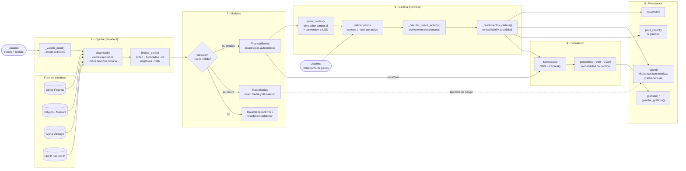

# market-toolkit

[](https://github.com/JAVIIFDEEZ/market-toolkit/actions/workflows/ci.yml)


Toolkit en Python para **descargar, estandarizar y analizar datos bursátiles** y **gestionar y
simular carteras de inversión**. Taller B1-T1 del máster MIAX.

- **Descarga multifuente:** Yahoo Finance (acciones e índices), Polygon (acciones), Alpha Vantage
  (oro, plata y Brent) y FRED/ALFRED (series macroeconómicas). Todas las fuentes devuelven el
  mismo tipo de objeto.
- **Series validadas con estadísticos automáticos:** `FinancialSeries` y `MacroSeries` comprueban
  los datos y calculan media, desviación típica, rentabilidad y volatilidad al crearse.
- **Limpieza y alineación temporal** entre activos con calendarios distintos, con conversión a USD.
- **Carteras** con pesos que pueden cambiar en el tiempo y que derivan entre rebalanceos.
- **Simulación de Monte Carlo** de un activo o de una cartera, con las correlaciones entre activos.
- **Informes:** `report()` en Markdown con métricas y advertencias de riesgo, y `plots_report()`
  con seis gráficos.

## Índice

- [Requisitos](#requisitos)
- [Instalación](#instalación)
- [Configuración de las claves](#configuración-de-las-claves)
- [Uso rápido](#uso-rápido)
- [Demo](#demo)
- [Tests](#tests)
- [Arquitectura](#arquitectura)
- [Estructura del proyecto](#estructura-del-proyecto)
- [Guía de uso](#guía-de-uso)
- [Autores](#autores)

## Requisitos

- **Python 3.11 o superior** ([descarga](https://www.python.org/downloads/)).
- **git**.
- Opcional: claves gratuitas de Polygon, Alpha Vantage y FRED. Yahoo Finance no necesita clave,
  así que el toolkit funciona sin ninguna (ver [Configuración de las claves](#configuración-de-las-claves)).

## Instalación

**1. Clonar el repositorio**

```bash
git clone https://github.com/JAVIIFDEEZ/market-toolkit.git
cd market-toolkit
```

**2. Crear y activar un entorno virtual**

macOS y Linux:

```bash
python3 -m venv .venv
source .venv/bin/activate
```

Windows (PowerShell):

```powershell
python -m venv .venv
.venv\Scripts\Activate.ps1
```

> Si PowerShell no deja activar el entorno, ejecuta una vez
> `Set-ExecutionPolicy -Scope CurrentUser RemoteSigned` y vuelve a intentarlo.
> En `cmd`, el comando es `.venv\Scripts\activate.bat`.

**3. Instalar el paquete con las dependencias de desarrollo**

```bash
pip install -e ".[dev]"
```

El modo `-e` (editable) hace que los cambios en `src/` se usen sin reinstalar. `[dev]` añade
`pytest`, `pytest-cov` y `ruff`.

**4. Comprobar la instalación**

```bash
pytest
```

## Configuración de las claves

Copia la plantilla `.env.example` como `.env` y rellena las claves que tengas:

```bash
cp .env.example .env        # macOS y Linux
copy .env.example .env      # Windows
```

| Variable | Fuente | ¿Obligatoria? | Dónde conseguirla |
| --- | --- | --- | --- |
| — | Yahoo Finance | No necesita clave | — |
| `POLYGON_API_KEY` | Polygon (Massive) | Solo para `PolygonProvider` | [polygon.io](https://polygon.io/) |
| `ALPHAVANTAGE_API_KEY` | Alpha Vantage | Solo para `AlphaVantageProvider` | [alphavantage.co](https://www.alphavantage.co/support/#api-key) |
| `FRED_API_KEY` | FRED / ALFRED | Solo para `MacroProvider` | [fred.stlouisfed.org](https://fred.stlouisfed.org/docs/api/api_key.html) |

El fichero `.env` está en el `.gitignore`, así que las claves nunca se suben al repositorio. Si
una clave no está en el `.env`, el proveedor la pide por pantalla al crearse.

## Uso rápido

```python
import pandas as pd

from market_toolkit.models import Portfolio
from market_toolkit.providers.providers import YahooFinanceProvider

# 1. Descargar: cada ticker se convierte en una FinancialSeries limpia y validada
series = YahooFinanceProvider(["AAPL", "MSFT", "JPM"]).download(inicio="2022-01-01", fin="2024-12-31")
series[0].resumen()  # media, desviación típica, rentabilidad y volatilidad anualizadas...

# 2. Crear una cartera con sus pesos iniciales
pesos = pd.DataFrame({"AAPL": [0.35], "MSFT": [0.35], "JPM": [0.30]},
                     index=[pd.Timestamp("2022-01-01")])
cartera = Portfolio(series, pesos)
cartera.resumen()

# 3. Simular y generar los informes
simulacion = cartera.simulacion_monte_carlo(n_simulaciones=5000, semilla=42)
print(cartera.report(tasa_libre_riesgo=0.04))
cartera.plots_report()
```

En la [Guía de uso](#guía-de-uso) se explican todos los proveedores, las opciones de la cartera y
los parámetros de la simulación.

## Demo

`examples/demo.py` recorre el toolkit de principio a fin: descarga acciones y un índice (y oro y
el tipo libre de riesgo si hay claves de Alpha Vantage y FRED), crea una cartera, la simula y
genera los informes.

```bash
python examples/demo.py              # datos reales
python examples/demo.py --sin-red    # datos sintéticos, sin conexión
python examples/demo.py --mostrar    # además, muestra los gráficos por pantalla
```

Si la descarga falla (sin conexión o con una API caída), la demo sigue con datos sintéticos. Los
resultados se guardan en `outputs/` (ignorada por git):

| Fichero | Contenido |
| --- | --- |
| `outputs/informe.md` | Informe en Markdown de la cartera |
| `outputs/graficos/*.png` | Los seis gráficos de `plots_report()` |
| `outputs/montecarlo/*.png` | Trayectorias y distribución del valor final de la simulación |

## Tests

```bash
pytest           # tests
ruff check .     # estilo y errores
```

Los tests usan datos sintéticos generados con semilla fija, así que no necesitan conexión. La
integración continua de GitHub (`.github/workflows/ci.yml`) ejecuta `ruff` y `pytest` con
Python 3.11 en cada push y pull request.

## Arquitectura



La capa de ingesta (`providers`) está desacoplada del resto: transforma cada fuente en el mismo
objeto estándar y los modelos nunca importan a los proveedores. Más detalle en
[docs/architecture](docs/architecture/README.md):

- [Diagrama de clases](docs/architecture/clases.md)
- [Dependencias entre módulos](docs/architecture/dependencias.md), hoy y en la arquitectura objetivo
- [Flujo de datos](docs/architecture/flujo.md)

Las decisiones de diseño se justifican en los ADR (*Architecture Decision Records*) de
[docs/adr](docs/adr/), por ejemplo la
[validación estricta de las series](docs/adr/0002-validacion-de-inputs.md).

## Estructura del proyecto

```
market-toolkit/
├── src/market_toolkit/
│   ├── config.py              # constantes y claves (.env)
│   ├── exceptions.py          # jerarquía de excepciones propias
│   ├── providers/             # ingesta: Yahoo, Polygon, Alpha Vantage y FRED
│   ├── preprocessing/         # limpieza, alineación temporal y validación
│   └── models/                # series, cartera, Monte Carlo y gráficos del informe
├── tests/                     # tests con datos sintéticos (pytest)
├── examples/demo.py           # demo de extremo a extremo
├── docs/
│   ├── architecture/          # diagramas (Mermaid)
│   └── adr/                   # decisiones de diseño
├── .env.example               # plantilla de las claves
└── pyproject.toml             # dependencias y configuración
```

## Guía de uso

<details>
<summary><h2>Descarga de Datos</h2></summary>

Todos los proveedores siguen la misma estructura: se crean con una lista de tickers (o series),
validan que existen y `download()` devuelve una **lista de series** ya limpias y validadas.

Las API keys se leen del fichero `.env` (si no están, se piden por pantalla):

```
POLYGON_API_KEY=tu_clave
FRED_API_KEY=tu_clave
```

<details>
<summary><h3>Acciones / Stocks</h3></summary>

Se descargan con `PolygonProvider` (Polygon.io, ahora Massive). El plan gratuito tiene dos
limitaciones que el proveedor gestiona solo:

- Solo cubre los **últimos 2 años**: si se pide una fecha anterior, se recorta y se avisa.
- Solo permite **5 llamadas por minuto**: espera `pausa` segundos (12 por defecto) entre
  llamadas, así que cada ticker tarda unos 12 s.

Solo admite acciones ordinarias (`CS`). ETFs, índices o tickers inexistentes se descartan con
un aviso.

#### Crear el proveedor

```python
from market_toolkit.providers.providers import PolygonProvider

polygon = PolygonProvider(["aapl", "MSFT", "SPY", "NOEXISTE"])
print(polygon)
```

```
UserWarning: Los tickers NOEXISTE, SPY no son equities o no existen en Polygon. Se eliminan de los datos de busqueda.
Polygon object tickers<AAPL, MSFT>
```

La API key también se puede pasar como argumento: `PolygonProvider(["AAPL"], api_key="...")`.

#### Descargar

`download()` devuelve una lista de `FinancialSeries` con los cierres ajustados de cada ticker.

```python
series = polygon.download()                                   # Últimos 2 años (por defecto)
series = polygon.download(periodo="6mo")                      # "3mo", "6mo", "1y", "2y" o "max"
series = polygon.download(inicio="2025-01-01", fin="2025-06-30")
series = polygon.download(fin="2026-01-01", periodo="6mo")    # Del 2025-07-01 al 2026-01-01

for s in polygon.download():
    print(s.activo, s.tipo, s.proveedor, s.inicio, s.fin, s.observaciones)
```

```
AAPL acción Polygon 2024-11-04 2026-11-02 500
MSFT acción Polygon 2024-11-04 2026-11-02 500
```

| Llamada | Resultado |
|---|---|
| `download()` | 2024-11-04 → 2026-11-02, 500 sesiones |
| `download(periodo="6mo")` | 2026-05-06 → 2026-11-02, 125 sesiones |
| `download(inicio="2025-01-01", fin="2025-06-30")` | 2025-01-02 → 2025-06-30, 122 sesiones |
| `download(inicio="2015-01-01")` | Se recorta a 2024-11-04 y avisa: `UserWarning: El plan de Polygon solo cubre desde 2024-11-04. Se recorta la fecha de inicio 2015-01-01.` |
| `download(inicio="2015-01-01", fin="2016-01-01")` | `ValueError`: el rango termina antes de lo que cubre el plan |
| `download(periodo="1mo")` | `ValueError` al momento, sin llamar a la API: periodo no válido |

Si solo se indica `inicio` o `fin`, `periodo` calcula la otra fecha; con las dos fechas, se
ignora.

#### Trabajar con una serie

Cada `FinancialSeries` calcula sus estadísticos al crearse. La moneda y la bolsa salen de los
detalles del ticker en Polygon: la bolsa es la principal de cotización (`NASDAQ`, `NYSE`...) y,
si Polygon no la indica, `Desconocido`. El precio es el consolidado de todos los mercados de
EE.UU.

```python
aapl = series[0]
aapl.resumen()
```

```
nombre                     Apple Inc.
activo                     AAPL
tipo                       acción
moneda                     USD
bolsa                      NASDAQ
proveedor                  Polygon
inicio                     2024-11-04
fin                        2026-11-02
observaciones              500
media_diaria               0.0010069361415077649
desviacion_tipica_diaria   0.018092462152309082
rentabilidad_anualizada    0.2886823205407585
volatilidad_anualizada     0.28720893275914944
```

Los estadísticos son de los **rendimientos diarios** (`precio_hoy / precio_ayer - 1`), no del
precio, y están en tanto por uno:

| Campo | Ejemplo | Significado |
|---|---|---|
| `media_diaria` | 0,10 % | Rendimiento medio por sesión |
| `desviacion_tipica_diaria` | 1,81 % | Volatilidad diaria |
| `rentabilidad_anualizada` | 28,9 % | `(1 + media_diaria)^252 - 1` |
| `volatilidad_anualizada` | 28,7 % | `desviacion_tipica_diaria × √252` |

```python
aapl.serie_temporal.tail(3)        # pd.Series con los precios
aapl.rendimientos().tail(3)        # Rendimientos simples
aapl.rendimientos("log").tail(3)   # Rendimientos logarítmicos
```

```
2026-10-30    344.63
2026-11-02    338.32
Name: AAPL, dtype: float64

2026-10-29    0.014775
2026-10-30   -0.012267
2026-11-02   -0.018309
Name: AAPL, dtype: float64

2026-10-29    0.014667
2026-10-30   -0.012343
2026-11-02   -0.018479
Name: AAPL, dtype: float64
```

Para tener todos los tickers en un `DataFrame`:

```python
import pandas as pd

df = pd.concat([s.serie_temporal for s in series], axis=1)
df.tail(3)
```

```
              AAPL    MSFT
2026-10-30  344.63  521.91
2026-11-02  338.32  507.12
```

</details>

<details>
<summary><h3>Índices / Market Index</h3></summary>

Pendiente de documentar. El plan gratuito de Polygon no incluye índices; se pueden descargar
con `YahooFinanceProvider`, que admite acciones e índices (por ejemplo `^GSPC` o `^IBEX`).

</details>

<details>
<summary><h3>Macro</h3></summary>

Se descargan con `MacroProvider`, que usa la API de FRED y, para datos históricos tal y como se
publicaron (sin revisiones posteriores), ALFRED.

Las series se indican con su ID de FRED (por ejemplo `DGS10`) o con un alias de
`MacroProvider.SERIES`:

| Alias | ID de FRED | Serie |
|---|---|---|
| `us10y` / `us2y` | `DGS10` / `DGS2` | Bono EE.UU. 10 / 2 años (%) |
| `us10y_2y` | `T10Y2Y` | Spread 10Y-2Y EE.UU. |
| `ipc_eurozona` | `CP0000EZ19M086NEST` | IPC armonizado de la Eurozona |
| `pib_espana` | `CLVMNACSCAB1GQES` | PIB real de España (trimestral) |
| `pib_eeuu` | `GDPC1` | PIB real de EE.UU. (trimestral) |
| `es10y` / `de10y` | `IRLTLT01ESM156N` / `IRLTLT01DEM156N` | Bono España / Alemania 10 años |
| `bce_depo` / `fed_funds` | `ECBDFR` / `DFF` | Tipo de depósito del BCE / Fed Funds |
| `cpi_eeuu` / `paro_eeuu` | `CPIAUCSL` / `UNRATE` | IPC / paro de EE.UU. |
| `eurusd`, `vix`, `wti`, `hy_spread`, `breakeven10y` | ... | Ver `MacroProvider.SERIES` |

#### Crear el proveedor

```python
from market_toolkit.providers.providers import MacroProvider

macro = MacroProvider(["us10y", "us10y_2y", "pib_espana", "ipc_eurozona", "NOEXISTE"])
print(macro)
```

```
UserWarning: Las series NOEXISTE no existen en FRED. Se eliminan de los datos de busqueda.
MacroProvider object series<CLVMNACSCAB1GQES, T10Y2Y, CP0000EZ19M086NEST, DGS10>
```

#### Descargar

`download()` devuelve una lista de `MacroSeries`. Sin parámetros descarga todo el histórico.

```python
series = macro.download()                                     # Todo el histórico
series = macro.download(periodo="5y")                         # "max", "<n>d", "<n>mo" o "<n>y"
series = macro.download(inicio="2024-01-01")
series = macro.download(inicio="2020-01-01", periodo="1y")    # Del 2020-01-01 al 2021-01-01

for s in macro.download(inicio="2024-01-01"):
    print(s.serie_temporal.name, s.nombre, s.unidad, s.observaciones)
```

```
CLVMNACSCAB1GQES   Real Gross Domestic Product for Spain                   Mil. of Chn. 2010 Euros  10
T10Y2Y             10-Year Treasury Constant Maturity Minus 2-Year ...     %                        709
CP0000EZ19M086NEST Harmonized Index of Consumer Prices: Total for Euro...  Index 2025=100           33
DGS10              Market Yield on U.S. Treasury Securities at 10-Year...  %                        708
```

Los valores negativos se conservan (tipos de interés, spreads...), a diferencia de las series
de precios.

#### Trabajar con una serie

```python
dgs10 = next(s for s in series if s.serie_temporal.name == "DGS10")
dgs10.resumen()
```

```
nombre             Market Yield on U.S. Treasury Securities at 10-Year Constant Maturity, Quoted on an Investment Basis
unidad             %
proveedor          FRED
inicio             2024-01-02
fin                2026-10-30
observaciones      708
media              4.332951977401129
desviacion_tipica  0.287962972944004
ultimo_valor       4.94
```

```python
dgs10.metadatos
dgs10.serie_temporal.tail(3)
```

```
{'nombre': 'Market Yield on U.S. Treasury Securities at 10-Year Constant Maturity, Quoted on an Investment Basis',
 'frecuencia': 'Daily', 'ajuste_estacional': 'NSA', 'ultima_actualizacion': '2026-11-02 15:16:54-06', 'vintage': None}

2026-10-28    5.05
2026-10-29    4.98
2026-10-30    4.94
Name: DGS10, dtype: float64
```

#### Cambiar la frecuencia

FRED puede agregar la serie a una frecuencia menor con `frecuencia` (`"d"`, `"w"`, `"bw"`,
`"m"`, `"q"`, `"sa"`, `"a"`) y `agregacion` (`"avg"` media, `"sum"` suma o `"eop"` último dato
del periodo). Es útil para juntar series de distinta frecuencia en un `DataFrame`:

```python
import pandas as pd

mensual = MacroProvider(["us10y", "us2y"]).download(periodo="6mo", frecuencia="m", agregacion="eop")
pd.concat([s.serie_temporal for s in mensual], axis=1)
```

```
            DGS2  DGS10
2026-05-01  3.98   4.45
2026-06-01  4.14   4.44
2026-07-01  4.28   4.75
2026-08-01  4.34   4.75
2026-09-01  4.88   5.29
2026-10-01  4.56   4.94
```

FRED fecha cada mes en su día 1, aunque con `"eop"` el valor sea el del último día del mes.

#### Datos históricos sin revisiones (ALFRED)

Con la opción `vintage` se obtienen los datos tal y como se conocían en una fecha
(`vintage="2020-01-01"`) o su primera publicación (`vintage="first"`). Estas series tienen
`proveedor="ALFRED"`.

```python
pib = MacroProvider(["pib_eeuu"])
antes = pib.download(inicio="2019-01-01", fin="2019-12-31", vintage="2020-01-01")[0]
hoy = pib.download(inicio="2019-01-01", fin="2019-12-31")[0]

pd.concat([antes.serie_temporal.rename("vintage_2020"), hoy.serie_temporal.rename("actual")], axis=1)
```

```
            vintage_2020     actual
2019-01-01     18927.281  20431.641
2019-04-01     19021.860  20602.275
2019-07-01     19121.112  20843.322
2019-10-01           NaN  20985.448
```

El 1-1-2020 aún no se había publicado el PIB del 4T de 2019, y los valores actuales son
distintos por las revisiones y el cambio de año base.

</details>

</details>

<details>
<summary><h2>Cartera</h2></summary>

`Portfolio` (en `models/portfolio.py`) agrupa una o varias series de precios (`FinancialSeries`)
con sus pesos. Al crearla se alinean las fechas, se pasan los precios a USD y se calculan sus
estadísticos.

### Crear una cartera

Hacen falta los activos y un `DataFrame` de pesos con un índice de fechas y una columna por activo:

```python
import pandas as pd

from market_toolkit.models import Portfolio
from market_toolkit.providers.providers import YahooFinanceProvider

series = YahooFinanceProvider(["AAPL", "SAN.MC", "VOD.L"]).download(inicio="2025-01-02",
                                                                    fin="2026-01-01")
pesos = pd.DataFrame(
    {"AAPL": [0.5], "SAN.MC": [0.3], "VOD.L": [0.2]},
    index=pd.to_datetime(["2025-01-02"]),
)
cartera = Portfolio(series, pesos)
```

Requisitos de los pesos:

- Las columnas deben ser exactamente los activos de la cartera. Cada peso se empareja con su
  activo **por nombre**, así que el orden de las columnas da igual.
- Los pesos de cada fecha deben **sumar 1**.
- El índice debe ser de fechas (`DatetimeIndex`).

### Cambiar los pesos en el tiempo

Solo se indican las fechas en las que cambian los pesos. Cada fila reparte el capital con esos
pesos y **se aplica ese mismo día**: el rendimiento de esa fecha ya usa los pesos nuevos. Si la
fecha no tiene sesión, se aplica en la siguiente. Entre una fila y la siguiente no se rebalancea
y los pesos evolucionan con los precios. Con una sola fila, se compra al inicio y no se toca más.

```python
cambios = pd.DataFrame(
    {"AAPL": [0.5, 0.2], "SAN.MC": [0.3, 0.6], "VOD.L": [0.2, 0.2]},
    index=pd.to_datetime(["2025-01-02", "2025-07-01"]),
)
con_cambio = Portfolio(series, cambios)
con_cambio.pesos.loc["2025-06-30":"2025-07-02"].round(4)
```

```
              AAPL  SAN.MC   VOD.L
Date
2025-06-30  0.3413  0.4548  0.2039
2025-07-01  0.2000  0.6000  0.2000
2025-07-02  0.2015  0.5945  0.2040
```

`cartera.pesos` da los pesos con los que empieza cada sesión. Cómo se leen estas tres filas:

- **30 de junio:** la cartera se creó el 2 de enero con 50/30/20, pero ya no tiene esos pesos porque
  no se rebalancea. SAN.MC ha subido mucho más que AAPL y por eso pesa más (45 % frente a 34 %).
- **1 de julio:** es la fecha del cambio, así que empieza la sesión con los pesos indicados, 20/60/20.
- **2 de julio:** los pesos evolucionan con el rendimiento del 1 de julio (AAPL +1,29 %, SAN.MC
  -0,38 %, VOD.L +2,52 %). Por ejemplo, AAPL pasa a
  `0,20 × 1,0129 / (0,20 × 1,0129 + 0,60 × 0,9962 + 0,20 × 1,0252) = 0,2015`.

Si la primera fila de pesos es anterior a los activos, la cartera empieza en la primera sesión con
los últimos pesos indicados hasta entonces. Si es posterior, la cartera empieza ese día y se
descartan los precios anteriores. En ambos casos se avisa.

### Estadísticos

Se calculan automáticamente al crear la cartera y se obtienen con `resumen()`:

```python
cartera.resumen()
```

```
precio_activos             ['AAPL', 'SAN.MC', 'VOD.L']
pesos_actuales             {'AAPL': 0.3350684087088535, 'SAN.MC': 0.4800346937069508, 'VOD.L': 0.1848968975841957}
moneda                     USD
inicio                     2025-01-02
fin                        2025-12-31
observaciones              245
media_diaria               0.0022004648843354942
desviacion_tipica_diaria   0.013674283583884875
rentabilidad_anualizada    0.7400397305550688
volatilidad_anualizada     0.2170725223195945
```

`pesos_actuales` son los pesos al cierre de la última sesión, después de evolucionar con los
precios.

El rendimiento diario de la cartera es la suma de los rendimientos de cada activo multiplicados
por los pesos con los que empieza esa sesión. Los pesos se aplican a las **rentabilidades**, nunca
a los precios, así que el precio de cada acción no influye.

| Estadístico | Atributo | Cálculo |
|---|---|---|
| `media_diaria` | `rentabilidad_media` | Media de los rendimientos diarios de la cartera |
| `desviacion_tipica_diaria` | `desviacion_tipica` | Desviación típica de esos rendimientos |
| `rentabilidad_anualizada` | `rentabilidad_anualizada` | `(1 + media_diaria)^252 - 1` |
| `volatilidad_anualizada` | `volatilidad_anualizada` | `desviacion_tipica_diaria × √252` |

`cartera.metadatos_activos` da la información de cada activo, con sus estadísticos en USD y sobre
las fechas de la cartera:

```
                               AAPL      SAN.MC       VOD.L
Información
moneda                          USD         USD         USD
inicio                   2025-01-02  2025-01-02  2025-01-02
fin                      2025-12-31  2025-12-31  2025-12-31
observaciones                   245         245         245
rentabilidad_anualizada    0.184128    1.912644    0.629926
volatilidad_anualizada     0.325491    0.328106    0.281661
```

### Correlación

`correlacion(t=x)` calcula la correlación entre los rendimientos diarios en USD de los activos
durante los últimos `x` años de la cartera (admite fracciones). Devuelve la matriz y la guarda
como imagen en `models/graficos/correlacion.png`, con escala de -1 a 1.

```python
cartera.correlacion(t=0.5)      # Últimos 6 meses
```

```
        AAPL  SAN.MC  VOD.L
AAPL    1.00    0.17   0.08
SAN.MC  0.17    1.00   0.11
VOD.L   0.08    0.11   1.00
```

- Si `x` es mayor que el histórico de la cartera, avisa y usa el periodo disponible.
- Cada pareja de activos usa **sus propias fechas comunes**, así que el hueco de un activo no
  afecta a la correlación de los otros dos. El título de la imagen indica las sesiones usadas.
- `correlacion.png` se conserva entre ejecuciones y simulaciones. Solo se borra al crear una
  cartera con otros activos o pesos.
- Con `guardar=False` solo devuelve la matriz, sin escribir la imagen.

### Calendario

Cada mercado tiene sus festivos. El parámetro `alineacion_temporal` decide qué hacer con las
fechas en las que no cotizan todos los activos:

| Opción | Qué hace | Fechas en el ejemplo |
|---|---|---|
| `"eliminacion"` (por defecto) | Elimina esas fechas | 245 |
| `"relleno"` | Usa el último precio conocido de cada activo | 258 |

```python
cartera = Portfolio(series, pesos, alineacion_temporal="relleno")
```

Con cualquiera de las dos opciones, la cartera empieza cuando existen todos sus activos.

**Limitaciones de los calendarios** al mezclar mercados distintos:

- **`"eliminacion"` junta varios días en un solo rendimiento.** Si se elimina una fecha, su
  movimiento se suma al de la sesión siguiente, y un dato así cuenta como una sola sesión. La
  volatilidad y la rentabilidad anualizadas pueden salir algo más altas.
- **`"relleno"` crea días con rendimiento 0.** El activo cerrado repite precio, lo que rebaja un
  poco su volatilidad y sus correlaciones.
- **Se anualiza siempre con 252 sesiones**, aunque el calendario común de la cartera tenga más o
  menos sesiones al año.
- **Los cierres no son simultáneos.** Europa cierra antes que EE.UU., así que lo que ocurre por la
  tarde en EE.UU. se refleja en Europa al día siguiente. Las correlaciones diarias entre mercados
  tienden a salir más bajas de lo real, con cualquiera de las opciones.
- **Tipo de cambio.** Su cierre diario tampoco coincide con el de cada bolsa y, si falta un día,
  se usa el último conocido.
- **Pocas fechas pueden importar mucho.** Un movimiento extremo junto a una fecha eliminada altera
  los resultados: en una prueba real con activos de EE.UU. y Europa, seis sesiones eliminadas en
  un año llevaron la correlación AAPL-MSFT de 0,155 a 0,008. Por eso `correlacion()` usa las
  fechas comunes de cada pareja; los estadísticos de la cartera y la simulación usan las fechas
  comunes a todos los activos, así que sus correlaciones pueden ser distintas de las de
  `correlacion()`.

### Monedas

Todos los precios de la cartera se pasan a **USD** con el tipo de cambio diario de Yahoo Finance
(`EURUSD=X`, `GBPUSD=X`...), de modo que las rentabilidades incluyen la variación de la divisa. Cada
activo debe tener su moneda informada. Si un día falta el tipo de cambio se usa el último conocido.
Si una divisa no tiene ningún dato con el que convertir, se lanza un `ValueError` que la indica.

Las cotizaciones en centésimas se ajustan automáticamente: `GBp` y `GBX` (peniques), `ZAc`
(céntimos de rand) e `ILA` (agorot). En el ejemplo, `VOD.L` cotiza en peniques y aparece en USD:

```python
cartera.precio_activos.tail(2)
```

```
                AAPL   SAN.MC   VOD.L
Date
2025-12-30  272.3387  11.6383  1.3311
2025-12-31  271.1220  11.5488  1.3314
```

### Rebalanceo

La cartera **no se rebalancea automáticamente**. Los pesos solo vuelven a un valor concreto en las
fechas indicadas en el `DataFrame` de pesos; el resto de días evolucionan con los precios.

### Informe gráfico

`plots_report()` genera seis gráficos de la cartera sobre todo su periodo, en USD. Los muestra por
pantalla, los guarda como PNG en `models/graficos/informe/` y devuelve un diccionario
`{nombre: figura}`:

```python
figuras = cartera.plots_report()                     # Muestra, guarda y devuelve las figuras
cartera.plots_report(mostrar=False)                  # Guarda sin abrir ventanas
cartera.plots_report(guardar=False)                  # Muestra sin escribir ficheros
cartera.plots_report(carpeta="resultados/cartera")   # Guarda en otra carpeta
```

| Parámetro | Qué hace | Por defecto |
|---|---|---|
| `mostrar` | Muestra los gráficos por pantalla | `True` |
| `carpeta` | Carpeta de destino de los PNG | `models/graficos/informe/` |
| `guardar` | Guarda los gráficos como PNG | `True` |

Cada ejecución sustituye los PNG del informe anterior, sin afectar a `correlacion.png` ni a los
gráficos de la simulación. En las fórmulas, `r(i,t)` es el rendimiento diario del activo `i`,
`w(i,t)` su peso al empezar la sesión `t`, `r(t) = Σ w(i,t) × r(i,t)` el rendimiento de la cartera
y `V(t) = 100 × Π (1 + r(t))` su valor en base 100.

**`evolucion`: evolución frente a los activos.** Compara la cartera (línea negra) con cada uno de
sus activos, todos partiendo de 100, para ver quién ha subido más independientemente de su precio.

- Cartera: `V(t)`, de modo que refleja los pesos y sus cambios.
- Cada activo: `100 × P(i,t) / P(i,0)`, con `P` el precio en USD.

**`drawdown`: caídas desde máximos.** Muestra cuánto pierde la cartera en cada momento respecto a
su máximo anterior; 0 % significa que está en máximos. Mide el peor momento que habría vivido un
inversor y marca la mayor caída del periodo.

- `drawdown(t) = V(t) / máx(V(s), s ≤ t) - 1`

**`pesos`: evolución de los pesos.** Muestra qué parte de la cartera hay en cada activo al empezar
cada sesión. Entre cambios, los activos que más suben ganan peso. Las líneas verticales marcan las
sesiones en las que se aplican pesos nuevos.

- En una fecha de cambio, `w(i,t)` es el peso indicado.
- El resto de sesiones: `w(i,t) = w(i,t-1) × (1 + r(i,t-1)) / Σ w(j,t-1) × (1 + r(j,t-1))`

**`riesgo_rentabilidad`: riesgo frente a rentabilidad.** Sitúa la cartera y cada activo según su
volatilidad (horizontal) y su rentabilidad (vertical). Muestra si la diversificación compensa:
cuanto más arriba y a la izquierda, más rentabilidad por unidad de riesgo.

- Rentabilidad anualizada: `(1 + media de los rendimientos diarios)^252 - 1`
- Volatilidad anualizada: `desviación típica de los rendimientos diarios × √252`

Son los mismos valores de `resumen()` y `metadatos_activos`, así que comparten las limitaciones de
anualizar con 252 sesiones descritas en *Calendario*.

**`contribucion`: contribución por activo.** Indica cuántos puntos porcentuales (pp) de la
rentabilidad total aporta cada activo, ordenados de mayor a menor. Tiene en cuenta el peso de cada
activo y lo que valía la cartera en cada momento. Permite ver de dónde ha salido el resultado: un
activo puede subir mucho y aportar poco si pesaba poco.

- `C(i) = Σ [V(t-1) / 100] × w(i,t) × r(i,t)`
- Las contribuciones suman exactamente la rentabilidad total: `Σ C(i) = V(final) / 100 - 1`

**`correlacion`: matriz de correlaciones.** Indica cuánto se mueven juntos los activos, de -1
(sentido opuesto) a 1 (a la vez). Cuanto más bajas, mayor es la diversificación. Es el mismo
cálculo que `correlacion()`, con la correlación de Pearson de los rendimientos diarios en USD y las
fechas comunes de cada pareja, pero sobre todo el periodo de la cartera.

Cada activo mantiene su color entre ejecuciones. Con más de 8 activos, los de menor peso medio se
agrupan en "Otros" en `evolucion` y `pesos`.

</details>

<details>
<summary><h2>Simulación</h2></summary>

`MonteCarlo` (en `simulation/montecarlo.py`) simula **miles de futuros posibles** de un activo
(`FinancialSeries`) o de una cartera (`Portfolio`) y resume qué puede pasar: cuánto se espera
ganar, qué probabilidad hay de perder y cuánto se puede perder en los peores escenarios.

```python
from market_toolkit.simulation.montecarlo import MonteCarlo

# Un activo: se crea el objeto MonteCarlo con la FinancialSeries
mc = MonteCarlo(aapl, n_simulaciones=5000, horizonte=252, semilla=42)
mc.resumen()

# Una cartera: se llama al método de Portfolio, que devuelve el MonteCarlo y muestra los gráficos
mc = cartera.simulacion_monte_carlo(horizonte=504, rentabilidad={"SAN.MC": 0.05})
mc.resumen()
```

`aapl` es la serie descargada en el apartado *Acciones / Stocks* y `cartera` es la creada en el
apartado *Cartera*.

### Cómo funciona

Cada simulación construye un camino día a día: el valor de hoy se multiplica por un rendimiento
diario **aleatorio**, sacado de una distribución normal (gaussiana). Repitiendo esto
`n_simulaciones` veces durante `horizonte` sesiones se obtiene un abanico de futuros posibles.

**1. De dónde salen la media y la desviación.** Se parte de dos supuestos anuales:

| Supuesto | Si no se indica, se usa el histórico |
|---|---|
| Rentabilidad anual `R` | `(1 + media de los rendimientos diarios)^252 - 1` |
| Volatilidad anual `σ` | `desviación típica de los rendimientos diarios × √252` |

En un activo son los mismos estadísticos que ya calcula `FinancialSeries` al crearse. En una
cartera son los de cada activo en `cartera.metadatos_activos`: en USD y sobre las fechas de la
cartera.

**La media y la volatilidad se pueden cambiar libremente.** El histórico solo se usa si no se
indica otra cosa:

```python
MonteCarlo(aapl, rentabilidad=0.08, volatilidad=0.20)   # 8 % y 20 % anual

# En una cartera, el mismo valor para todos los activos...
cartera.simulacion_monte_carlo(rentabilidad=0.08, volatilidad=0.20)
# ...o un valor por activo: los que no se indiquen mantienen su histórico
cartera.simulacion_monte_carlo(rentabilidad={"SAN.MC": 0.05}, volatilidad={"AAPL": 0.30})
```

Los valores son por activo, así que `volatilidad=0.20` no significa que la cartera tenga un 20 %:
por la diversificación suele ser menor. Las correlaciones siempre son las históricas.

**2. Paso a diario.** Los supuestos anuales se convierten a un día (252 sesiones al año):

- Rendimiento diario esperado: `m = (1 + R)^(1/252) - 1`
- Volatilidad diaria: `s = σ / √252`

**3. La gaussiana.** El rendimiento logarítmico de cada día se saca de una normal con:

- **Desviación** `s`.
- **Media** `ln(1 + m) - s²/2`. El `- s²/2` es una corrección para que, de media, el activo
  crezca exactamente al ritmo supuesto. Sin ella, la simulación sobrestimaría la rentabilidad.

**En una cartera**, los activos se simulan a la vez y sus movimientos diarios mantienen las
**correlaciones históricas** entre ellos (si dos activos suelen subir juntos, en la simulación
también). Después se combinan con los **pesos actuales** de la cartera (al cierre de su última
sesión). El resultado está en USD. Por defecto **no hay rebalanceo**:

- `rebalanceo=False` (por defecto): se compra al inicio con esos pesos y no se toca la cartera.
- `rebalanceo=True`: los pesos se restablecen todos los días.

### Parámetros

| Parámetro | Qué hace | Por defecto |
|---|---|---|
| `n_simulaciones` | Número de caminos simulados | 1000 |
| `horizonte` | Sesiones a simular (252 = un año) | 252 |
| `rentabilidad`, `volatilidad` | Media y volatilidad anuales, a elección del usuario. En una cartera, un número para todos los activos o un diccionario por activo | Históricas |
| `valor_inicial` | Valor de partida | Último precio del activo, o 100 USD en una cartera |
| `rebalanceo` | Solo carteras: `False` compra y mantiene y `True` restablece los pesos cada día | `False` |
| `semilla` | Fija el azar para obtener siempre el mismo resultado | `None` |
| `guardar_graficos` | Guarda los gráficos de la simulación | `True` |

Ejemplo con todos los parámetros retocados:

```python
from market_toolkit.simulation.montecarlo import MonteCarlo

# Un activo: supuestos fijados a mano
mc_activo = MonteCarlo(
  aapl,  # FinancialSeries a simular
  n_simulaciones=10_000,  # 10.000 caminos
  horizonte=504,  # 2 años de sesiones
  rentabilidad=0.08,  # 8 % anual esperado
  volatilidad=0.25,  # 25 % de volatilidad anual
  valor_inicial=10_000,  # Se parte de 10.000 USD en lugar del último precio
  semilla=42,  # Resultado reproducible
  guardar_graficos=True,  # Borra los gráficos anteriores y guarda los nuevos
)

# Los resultados también se pueden ajustar
mc_activo.percentiles((1, 10, 50, 90, 99))  # Percentiles a elección en cada sesión
mc_activo.var(0.99)  # VaR con otra confianza
mc_activo.cvar(0.99)  # CVaR con otra confianza
mc_activo.graficar(n_trayectorias=100)  # Mostrar por pantalla con 100 caminos de fondo
mc_activo.guardar_graficos(n_trayectorias=100, carpeta="mis_graficos")  # Guardar en otra carpeta
```

### Resultados

| Resultado | Qué es |
|---|---|
| `trayectorias` | Todos los caminos: una fila por sesión y una columna por simulación |
| `valores_finales` | Valor de cada simulación al final del horizonte |
| `rentabilidades_finales` | Rentabilidad acumulada de cada simulación (`valor final / valor inicial - 1`) |
| `percentiles()` | Percentiles 5, 25, 50, 75 y 95 del valor en cada sesión |
| `var(0.95)` | **Value at Risk**: la pérdida que solo se supera en el 5 % peor de los escenarios |
| `cvar(0.95)` | **Conditional VaR**: la pérdida media dentro de ese 5 % peor de los escenarios |
| `resumen()` | Diccionario con los supuestos y los resultados principales |

Cómo leer el VaR y el CVaR: con `var(0.95) = 0.24` y `cvar(0.95) = 0.29`, en 95 de cada 100
escenarios no se pierde más de un 24 %, y en los 5 peores se pierde de media un 29 %. Ambos se
dan en tanto por uno sobre el valor inicial (positivos cuando son pérdidas). También se pueden
pedir con otra confianza, por ejemplo `var(0.99)`.

`resumen()` incluye además el valor final medio y mediano, los percentiles 5 y 95 del valor
final, la rentabilidad media, la **probabilidad de pérdida** (porcentaje de escenarios que acaban
por debajo del valor inicial), el VaR y el CVaR al 95 %.

### Gráficos

Al crear el objeto se sustituyen los dos gráficos de la simulación anterior en
`models/graficos/` (con `mc.graficar()` también se muestran por pantalla):

- `trayectorias.png`: una muestra de caminos, las bandas de percentiles 5-95 y 25-75, la media y
  la mediana.
- `distribucion.png`: histograma del valor final (pérdidas en naranja y ganancias en verde) con
  el valor inicial, la media, la mediana, el VaR 95 % y el VaR 99 %.

### Limitaciones

- Supone rendimientos **normales**: los movimientos extremos (crisis) son más frecuentes en la
  realidad, así que el VaR y el CVaR pueden quedarse cortos.
- La rentabilidad, la volatilidad y las correlaciones se mantienen **constantes** durante todo el
  horizonte.
- Con supuestos históricos, se asume que el futuro se comportará como el pasado del periodo
  descargado.

</details>

## Autores

- [JAVIIFDEEZ](https://github.com/JAVIIFDEEZ)
- [Mgalvaz](https://github.com/Mgalvaz)
- [galartiker](https://github.com/galartiker)
