# Diagrama de clases

Jerarquía de clases del toolkit y relaciones entre ellas. Lo cubre el apartado 4.6 del enunciado
junto con [dependencias](dependencias.md) y [flujo](flujo.md).

Código fuente: [`diagramas/clases.mmd`](diagramas/clases.mmd)

## Cómo leerlo

| Símbolo | Significado |
| --- | --- |
| Flecha con punta de triángulo hueco | Herencia: la clase hija es un caso de la madre |
| Rombo hueco | Composición: una `Portfolio` agrupa una o varias `FinancialSeries` |
| Flecha discontinua | Dependencia: una clase crea, usa o lanza la otra |
| Recuadro con nombre | Paquete del código al que pertenece la clase |
| `<<dataclass frozen>>` | Dataclass inmutable: se valida y calcula sus estadísticos al crearse |
| `<<abstract>>` | Clase abstracta: define la interfaz común de los proveedores |
| `<<module>>` | Módulo de funciones (no es una clase) |

## Decisiones que refleja

- **Un contrato para todas las fuentes.** Todos los proveedores heredan de `Provider` y
  `download()` siempre devuelve una lista de series. Añadir una fuente nueva es añadir una
  subclase, sin tocar los modelos.
- **Un único tipo de dato estándar.** Venga de donde venga, el precio de un activo es una
  `FinancialSeries`. Así la cartera, la simulación y los informes no dependen de la fuente.
- **Series y macro comparten base.** `FinancialSeries` y `MacroSeries` heredan de `SerieTemporal`
  (índice de fechas, metadatos, validación), pero cada una calcula sus propios estadísticos: de
  rendimientos en los precios y del nivel en las series macro.
- **Los tipos de activo son un Enum.** `TipoActivo` distingue acciones, índices, ETF y materias
  primas. La cartera lo usa para rechazar los índices: no se pueden comprar, así que en su lugar
  hay que usar un ETF que los replique.
- **Excepciones propias en jerarquía.** Se pueden capturar todas (`MarketToolkitError`), solo las
  de las APIs (`ProviderError`) o solo las de validación (`DataValidationError`).
- **Cada clase en su paquete.** Los recuadros agrupan las clases por paquete (`providers`,
  `models`, `simulation` y `exceptions`), igual que en el código.

- **Los cálculos reutilizables, fuera de las clases.** `analytics` (benchmark y colas de la t) y
  `reporting` (HTML) son módulos de funciones puras: `Portfolio` y `MonteCarlo` los usan, pero no
  al revés.

`Fundamentales` está definida pero todavía no la usa ningún proveedor.
