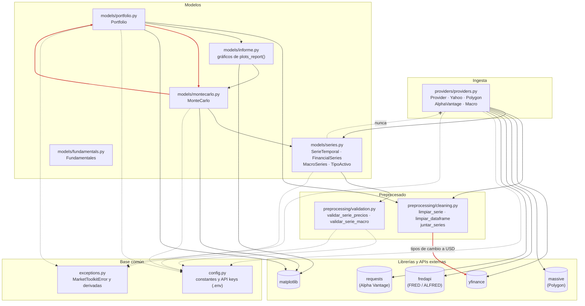
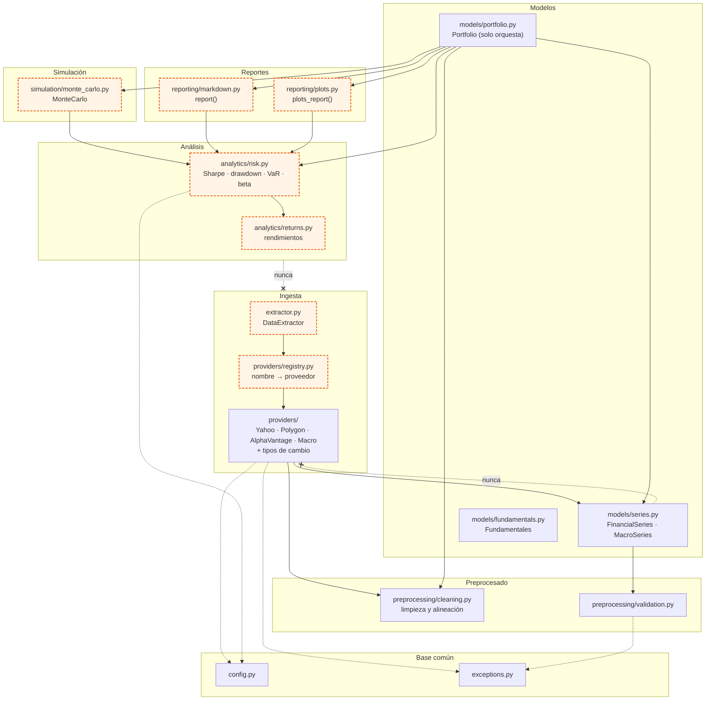

# Dependencias entre módulos

Cada flecha `A → B` significa «A importa B». Las líneas discontinuas son dependencias de la base
común (`config` y `exceptions`), que cualquier módulo puede usar.

## Estado actual

La regla principal se cumple: **`models` nunca importa `providers`**, así que los modelos no saben
de dónde vienen los datos. Las flechas en rojo son los acoplamientos que quedan por resolver:

| Acoplamiento | Por qué conviene quitarlo |
| --- | --- |
| `portfolio` ↔ `montecarlo` (y `informe` → `montecarlo`) | Los módulos se importan entre sí. Funciona porque se importan como módulo y no por nombre, pero cualquier cambio en el orden de los imports puede romperlo y hace difícil probarlos por separado |
| `cleaning` → `yfinance` | El preprocesado descarga tipos de cambio de Yahoo para pasar la cartera a USD. Crear una `Portfolio` con activos que no estén en USD llama a internet aunque los precios vengan de otra fuente |

## Arquitectura objetivo

Cómo quedaría el paquete al rellenar los módulos que hoy están vacíos (`extractor.py`,
`analytics/`, `simulation/` y `reporting/`). En naranja, lo pendiente.

- `Portfolio` solo **orquesta**: delega los cálculos en `analytics`, la simulación en `simulation`
  y los informes en `reporting`.
- `analytics` son funciones puras sobre pandas: no dependen de ningún otro módulo del paquete,
  así que se pueden probar con datos sintéticos y reutilizar en cualquier sitio.
- Los tipos de cambio pasan a ser un proveedor más, y el preprocesado solo limpia y alinea.
