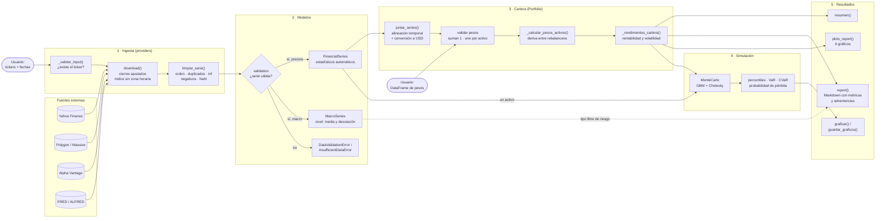

# Flujo de datos

Recorrido de los datos desde que se piden a una API hasta los resultados.

1. **Ingesta.** Cada proveedor comprueba los tickers, descarga los precios de cierre ajustados,
   quita la zona horaria del índice y los limpia con `limpiar_serie()`.
2. **Modelos.** La validación es estricta (ver
   [ADR 0002](../adr/0002-validacion-de-inputs.md)): si la serie no es válida se lanza una
   excepción; si lo es, la serie calcula sus estadísticos al crearse.
3. **Cartera.** `Portfolio` junta las series, alinea los calendarios, pasa los precios a USD,
   valida los pesos y calcula cómo derivan entre rebalanceos.
4. **Simulación.** `MonteCarlo` simula un activo o la cartera con un movimiento browniano
   geométrico, con las correlaciones históricas entre activos (descomposición de Cholesky).
5. **Resultados.** Resumen, informe en Markdown con advertencias de riesgo y gráficos.
