# Flujo de datos

Recorrido de los datos desde que se piden a una API hasta los resultados.

Código fuente: [`diagramas/flujo.mmd`](diagramas/flujo.mmd)

1. **Ingesta.** Los activos se piden por ticker o, en Yahoo, por nombre (`desde_nombres`). Cada
   proveedor comprueba que existen y son de un tipo admitido, descarga los precios de cierre
   ajustados, quita la zona horaria del índice y los limpia con `limpiar_serie()`.
2. **Modelos.** La validación es estricta (ver
   [ADR 0002](../adr/0002-validacion-de-inputs.md)): si la serie no es válida se lanza una
   excepción; si lo es, la serie calcula sus estadísticos al crearse.
3. **Cartera.** `Portfolio` rechaza los índices (no se pueden comprar; en su lugar se usa un ETF
   que los replique), junta las series, alinea los calendarios, pasa los precios a USD, valida
   los pesos y calcula cómo derivan entre rebalanceos.
4. **Simulación.** `MonteCarlo` simula un activo o la cartera con un movimiento browniano
   geométrico, con las correlaciones históricas entre activos (descomposición de Cholesky).
5. **Resultados.** Resumen, informe en Markdown (métricas, diagnósticos, advertencias de riesgo y
   fortalezas), seis gráficos de la cartera y los gráficos de la simulación.
